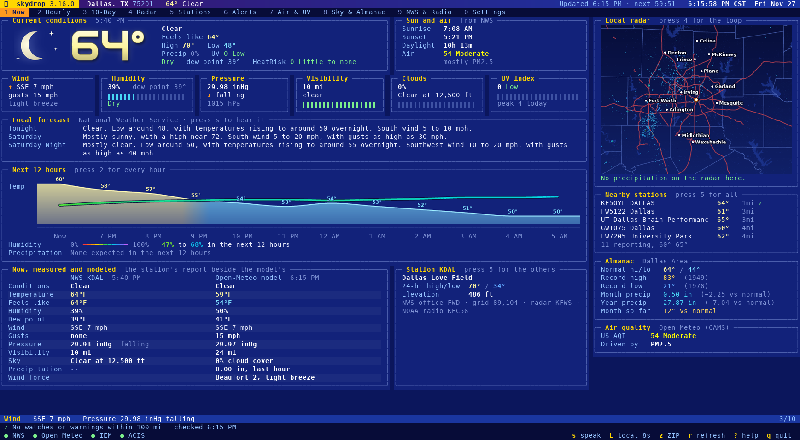
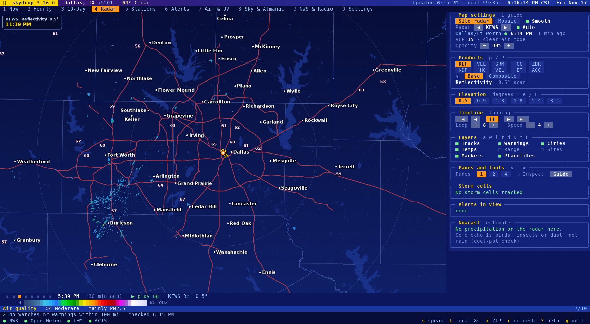
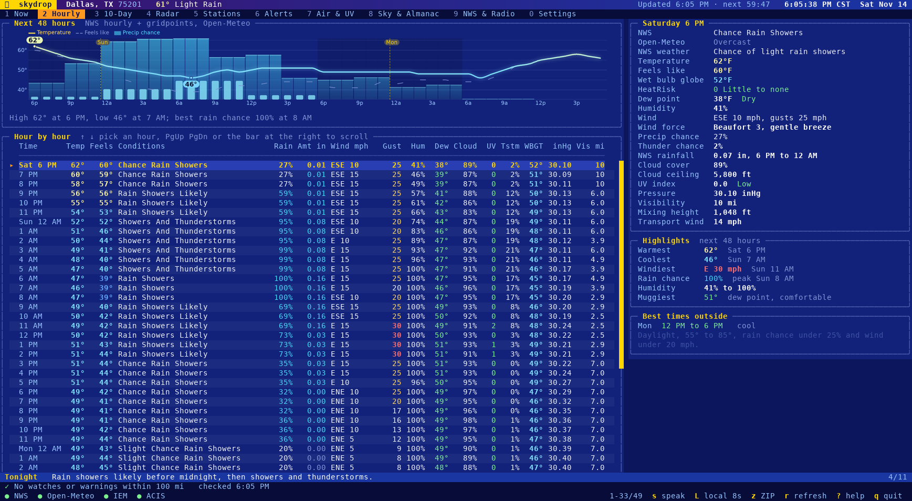
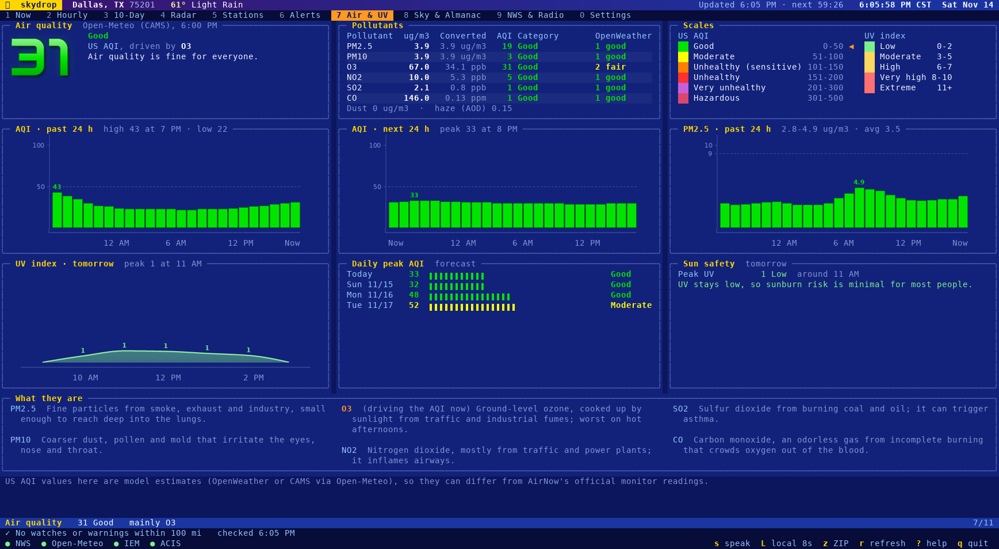
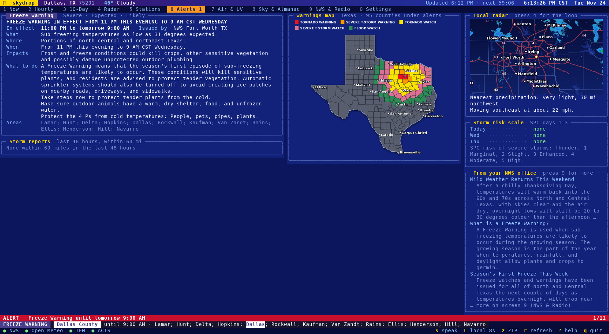
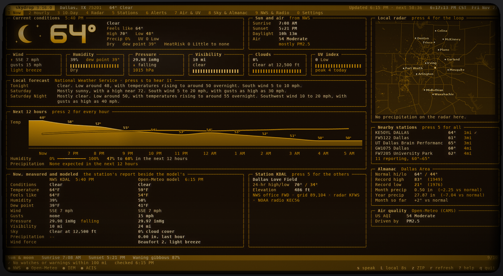
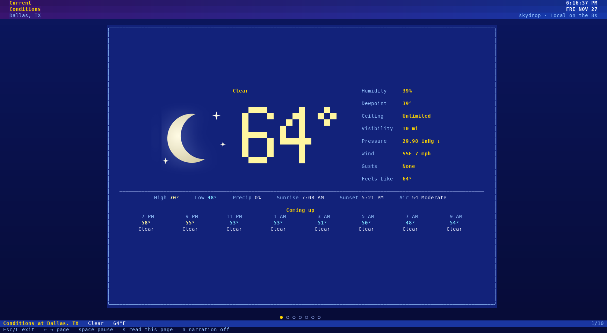

# 💧 skydrop

Retro TV weather for your terminal, on **Linux, macOS and Windows**. skydrop
brings the look of the 1990s Weather Channel "Local on the 8s" to the
command line, along with serious weather tools: single-site NEXRAD radar
modeled on Supercell Wx, a live warnings crawl and county warnings map, a
NOAA Weather Radio style tornado alarm for your ZIP code, a feed from every
weather station around you, and forecasts read aloud in a natural voice.

It draws real pictures in terminals that can show them (kitty and Ghostty on
Linux and macOS, Windows Terminal, WezTerm, iTerm2, Konsole, foot and other
sixel terminals) and a block-character version everywhere else (Tilix, GNOME
Terminal, macOS Terminal, tmux and the rest).



| | | |
|---|---|---|
|  |  |  |
|  |  |  |

Every screen, in every theme and drawing mode, is in the screenshots archive
in the [release](release) folder.

**No account or API key is needed.** The National Weather Service and other
free, open data sources cover everything. If you have your own OpenWeather
key, you can add it in Settings as an extra source.

## Features

* **Linux, macOS and Windows**: a .deb for Debian and Ubuntu, installers for
  any Linux, macOS and Windows 10/11, the same pictures in kitty and Ghostty
  on Linux and macOS, and in Windows Terminal (as sixel images) on Windows.
* **Nine screens**: current conditions, a 48-hour chart and table, a 10-day
  outlook, radar, a live station feed, alerts, air quality and UV, sky and
  almanac, and your NWS office's discussions and weather radio script.
* **Radar like Supercell Wx**: one NEXRAD radar at full resolution, decoded
  from its own Level 3 products: reflectivity, velocity, storm-relative
  velocity, correlation coefficient, differential reflectivity, specific
  differential phase, hydrometeor classification, echo tops, VIL, rain rate
  and rainfall totals, at six elevation angles. A toolbox of buttons and
  switches, 1, 2 or 4 linked panes, storm cell tracks with hail, mesocyclone
  and tornado vortex signatures, an inspect crosshair, GRLevelX color tables
  and placefiles, and the national NOAA MRMS mosaic one key away.
* **Warnings crawl**: watches, warnings, advisories and storm reports along
  the bottom of every screen as they're issued, each in the National Weather
  Service's own color for it, each warning's counties slowly scrolling by,
  and your county's name, lit up, pinned right after the warning's name
  while one covers it.
* **Warnings map**: the Alerts screen shows your state the way a TV station
  does, each county filled with the color of the watch, warning or advisory
  it is under, with a key and your location marked.
* **Tornado alarm**: when a new Tornado Warning covers your ZIP code, skydrop
  sounds the NOAA Weather Radio alarm, puts up a red banner and reads the
  warning aloud. *Watch when closed* keeps watching even when skydrop isn't
  open.
* **Refreshes every 30 seconds** (alerts, radar scans and observations), and
  requests that haven't changed cost almost nothing.
* **Local on the 8s**: a full-screen, WeatherSTAR-style presentation mode
  whose pages advance by themselves, with optional narration.
* **Read aloud**: press `s` on any forecast screen. The voice comes from
  Piper and runs offline on your computer.
* **Five themes**, from royal-blue WeatherSTAR to a light 1970s magnetic
  weather board.
* **CRT mode**: the whole app as if on an old cathode-ray tube: a power-on
  sweep and a BIOS-style POST screen, text typed in down a serial line, green,
  amber or white phosphor, and in kitty or Ghostty real glass (scanlines,
  bloom, curvature, glare, a bezel and more). Every one of the 21 effects can
  be switched off or turned up on the CRT effects card, with six meter looks
  and a bitmap-style font to finish it, which skydrop sets in kitty for you,
  size and all.
* **Charts to read at a glance**: the next 12 hours of temperature, the UV
  index through the day and the month's daily highs are area charts. In a
  terminal that draws pictures (kitty, Ghostty, or one with sixel) they're
  pictures: a smooth curve through the readings that never bulges past them,
  a crisp line along its top and the area shaded under it; elsewhere they're
  drawn to an eighth of a cell. Under the next 12 hours' temperature, each
  hour that may bring precipitation has a bar as tall as its chance, colored
  by what falls, as on weather radar: rain in shades of green from light to
  heavy, thunderstorms gold, snow white, sleet pink, freezing rain magenta and
  a wintry mix violet. Over the temperature, a line tracks the humidity hour
  by hour, colored along the whole spectrum: red for the driest air, then
  orange, yellow, green, cyan and blue, to violet for the most humid. A
  station's last 24 hours and the air quality's past and next 24 hours are
  solid columns, each outlined so they stand apart and colored by how high it
  ran.
* **Panels, like a TV weather display**: every screen is laid out in rounded,
  filled cards that stand on the page, each part in its own titled card;
  long tables have every other row shaded, and the title bar shows skydrop's
  version and the temperature and sky right now on every screen. Square
  corners for fonts without the rounded ones, plain `+-|` in ASCII mode;
  under CRT mode the cards stay flat, as a tube would show them.
* **Keyboard and mouse**: every screen, button and setting works from the
  keyboard; click, drag and scroll work too.

## Requirements

| | Linux | macOS | Windows |
|---|---|---|---|
| System | Ubuntu, Debian, Mint, Fedora and most others | macOS 12 or newer | Windows 10 or 11 |
| Python | 3.8 or newer (already there on most distributions) | 3.8 or newer: Homebrew's (`brew install python`) or Apple's (`xcode-select --install`) | 3.8 or newer; the installer offers to install it |
| Full pictures | kitty, Ghostty, WezTerm, Konsole, foot | kitty or Ghostty (the same look as on Linux); iTerm2 and WezTerm (sixel) | Windows Terminal 1.22 or newer (sixel) |
| Block-character look | Tilix, GNOME Terminal, Xfce Terminal and the rest | Terminal | the older console window |

skydrop runs in any terminal; the table shows where it draws real pictures.
Windows Terminal comes with Windows 11 and is in the Microsoft Store for
Windows 10. On a Mac, `brew install --cask kitty` or
`brew install --cask ghostty` gets the full look.

## Install

Download the file for your system from the [release](release) folder (the
version here is 3.16.0), then:

### Debian, Ubuntu and Mint: the .deb package

```bash
cd ~/Downloads && sudo apt install ./skydrop_3.16.0_all.deb && skydrop --version
```

apt pulls in what skydrop needs (Python's Pillow, the DejaVu fonts, espeak-ng
for read-aloud, an audio player and desktop notifications). The program goes
in `/usr/lib/skydrop` and runs on the system's Python, so read-aloud uses
espeak-ng; for the natural Piper voice use the installer archive below
instead. Upgrade by installing a newer .deb the same way; remove it with
`sudo apt remove skydrop`.

### Any Linux: the installer archive

```bash
cd ~/Downloads && tar xzf skydrop-3.16.0-linux.tar.gz && cd skydrop-3.16.0 && ./install.sh && skydrop --version
```

Everything goes in your home folder; nothing needs root except optional
system packages. The installer sets up a private Python with Pillow
(pictures) and Piper (the offline voice, about 70 MB), downloads one voice,
adds the `skydrop` command and an applications-menu entry, and offers to
test the data sources. On Debian-based systems it offers to add
`python3-venv`, `espeak-ng`, `alsa-utils` and `libnotify-bin` with apt,
asking for your password only if something is missing. Installer options:

```
./install.sh --no-voice     skip the Piper voice (read-aloud uses espeak-ng)
./install.sh --voice NAME   use another Piper voice, e.g. en_US-lessac-medium
./install.sh --no-apt       never run sudo apt-get
./install.sh --yes          answer yes to every question
```

Use either the .deb or the installer archive, not both: whichever comes
first on your PATH wins.

### macOS

Download `skydrop-3.16.0-macos.zip` and double-click it if your browser
hasn't unpacked it already. Then, in Terminal:

```bash
cd ~/Downloads/skydrop-3.16.0-macos && bash install.sh && ~/.local/bin/skydrop --version
```

The installer works as on Linux: a private Python with Pillow and Piper in
`~/.local/share/skydrop`, the `skydrop` command in `~/.local/bin` (added to
your PATH in `~/.zshrc`; open a new window for it to take effect). Sound,
the backup voice and notifications use what macOS already has (`afplay`,
`say`, Notification Center). Run skydrop in kitty or Ghostty for the full
pictures.

### Windows

1. Download `skydrop-3.16.0-windows.zip`, right-click it and choose
   **Extract All**.
2. Open the extracted folder and double-click **install.cmd**. If Windows
   SmartScreen says it protected your PC, choose **More info**, then
   **Run anyway** (the installer is a plain script; read it first if you
   like).

The installer finds Python (or offers to install Python 3.13 with winget),
sets up a private Python with Pillow and Piper in `%LOCALAPPDATA%\skydrop`,
adds the `skydrop` command to your PATH, a **skydrop** shortcut to the Start
menu, and two profiles to Windows Terminal: **skydrop** and **skydrop CRT**
(the same with Windows Terminal's own scanline effect). Options, from a
terminal in that folder:

```
install.cmd -NoVoice       skip the Piper voice (read-aloud uses Windows' own voice)
install.cmd -Voice NAME    use another Piper voice, e.g. en_US-lessac-medium
install.cmd -Yes           answer yes to every question
```

Start skydrop from the Start menu, from Windows Terminal's new-tab menu, or
by typing `skydrop` in a new terminal window. In Windows Terminal 1.22 or
newer every picture shows (as sixel images); the older console window gets
the block-character look.

For kitty's exact look on Windows, install the Linux version inside WSL
(Windows Subsystem for Linux) and run it in kitty there (`sudo apt install
kitty` in WSL; Windows 11 shows Linux windows on the desktop).

### From a clone of this repository

Run `./install.sh` (Linux and macOS) or `install.cmd` (Windows) from the
repository's folder.

Running any installer again upgrades skydrop and keeps your settings.

## First run

Type `skydrop`. It starts with the weather for **Dallas, TX (75201)**. To use
your own location, press `z`, type your ZIP code (or a place such as
`Memphis, TN`) and press Enter. It's saved for next time.

Then look around: the number keys `1` to `9` switch screens, `0` opens
Settings, `?` shows every key, and `q` quits.

### API keys (all optional)

skydrop ships with no keys, and none are needed. To add your own, open
Settings (`0`), then the section (highlight its title and press Enter):

* **OpenWeather > API key**: a free key from
  [openweathermap.org](https://openweathermap.org/api) adds OpenWeather's
  current conditions and air quality as extra sources (and minute-by-minute
  rain with a One Call subscription). *Daily call cap* keeps you within your
  plan.
* **National Weather Service > User-Agent**: the NWS asks every app to
  identify itself. skydrop sends a generic one by default; put your own here,
  such as `skydrop (you@example.com)`, so the NWS can reach you if your
  requests ever cause a problem.
* **National Weather Service > API key**: only if the NWS has given you one.
  The NWS API is free and doesn't require a key.

Keys are kept in your settings file, which only you can read:
`~/.config/skydrop/config.json` on Linux and macOS,
`%APPDATA%\skydrop\config.json` on Windows.

## Screens

Press the number key to jump to a screen, or Tab and the arrow keys to move
between them. Every screen fills the space it has: on a wide terminal the
right-hand sidebar adds radar, stations, almanac and more.

| Key | Screen | What's on it |
|-----|--------|--------------|
| 1 | Now | Current conditions with a big temperature (in kitty or Ghostty, in a rounded, squared display face shaded in its color) and icon; a row of tiles for wind (with an arrow showing where it blows), humidity, pressure and its trend, visibility, clouds and UV; the NWS forecast in words; the next 12 hours in one chart (the temperature, colored by how warm it is, with the humidity as a line over it, colored along the spectrum from red for the driest air to violet for the most humid, over a bar for each hour precipitation may fall, as tall as its chance and colored by what falls: rain in greens from light to heavy, storms gold, snow white, sleet pink, freezing rain magenta, a wintry mix violet, with a key under it for each); the nearest official station's report beside the model's, row by row; and a sidebar with the local radar, nearby stations, almanac, outlooks and air quality |
| 2 | Hourly | A 48-hour chart (a smooth temperature line colored by how warm it is, the night hours shaded, the high and low tagged, a line every 5°, the 10s labeled) over a table of every hour, which scrolls (a scroll bar down its right edge shows where you are): temperature, feels-like, rain chance and amount, wind, gusts, humidity, dew point, clouds, UV, thunder chance, wet-bulb globe temperature, pressure, visibility; details for the selected hour, highlights, and the best times to be outside |
| 3 | 10-Day | Icons for each day, a table with temperature range bars (in kitty or Ghostty, pills shaded through the temperatures they span, on one scale, with a dot for now on today) and NWS HeatRisk (columns with nothing to show stay out), "the outlook at a glance", a highs-and-lows chart (smooth curves with the band between them shaded in the temperatures' colors), and the selected day's full NWS text plus hour by hour |
| 4 | Radar | Single-site NEXRAD radar with every Level 3 product and tilt (or the national mosaic), the Supercell-style toolbox, linked panes, storm tracks, warning polygons, placefiles, and a nowcast that estimates when rain will reach you |
| 5 | Stations | Live readings from every station in and around your ZIP code: airport ASOS/AWOS, citizen CWOP stations, state road-weather sensors, co-op, river and soil networks, with a map, each station's last 24 hours (temperature, wind and pressure in solid bars, an hour each, every bar outlined) and a log of the newest reports |
| 6 | Alerts | Each NWS watch, warning and advisory in its own card, its name in the warning's color, its text set out as What, Where, When, Impacts and What to do; a TV-style warnings map in the top right, every county in your state filled with the color of the most serious watch, warning or advisory it is under, with a key of what is in effect and how many counties each covers, the bigger cities named and your location marked (where the map can't be drawn, the regional radar with the warning outlines takes its place); storm-based warnings nearby, SPC watches and local storm reports in cards beside them (each goes under the shorter column, so more fits at once); and a sidebar with the local radar, the SPC severe and WPC excessive-rain outlooks for your exact point, the storm risk scale and the Hazardous Weather Outlook |
| 7 | Air & UV | A screen of rounded cards, sized to fit at once in a window of about 160 x 45 or more: the US AQI now (in kitty or Ghostty, a big number in the same display face as the temperature, in its category's color), every pollutant and the AQI and UV scales; solid outlined column charts, like the Stations screen's, of the AQI and PM2.5 over the past 24 hours and the AQI over the next 24, each column colored by its category, with a scale on the left and the peak marked, and an area chart of the UV index through the day; the daily peaks, sun safety and sunburn time, and a short guide to what each pollutant is. The charts grow to fill a taller window |
| 8 | Sky & Almanac | Cards for the sun (sunrise, sunset and twilight) beside the moon and its phases, the day's light and dark in one bar, normals and records from NOAA beside the week ahead, and this month's daily highs as an area chart, the normal dotted across it; a sidebar with today's moon (drawn, with its seas, craters and the earthshine on its dark side), the sun's path, the next solstice and clock change, and daylight through the year (a golden curve, today marked) |
| 9 | NWS & Radio | The NOAA Weather Radio broadcast script, your NWS office's briefing, weather stories and headlines, the Hazardous Weather Outlook and the Area Forecast Discussion, each in a card. A wide window runs the cards down newspaper columns: a long one carries on at the top of the next column |
| 0 | Settings | Every setting in sections that open and close (Location, Display, Tornado alarm, Radar and the rest), the data sources, connection tests and the Active errors list |
| L | Local on the 8s | Full-screen WeatherSTAR-style pages that advance by themselves. Press `n` to have every page read aloud |

### The Settings screen

Settings opens with every section closed, so the list is just their titles:
Location, Display, Tornado alarm, Warnings crawl, Radar, Station feed, Voice
and sound, OpenWeather, National Weather Service and Data sources. Each title
says how many settings it holds, and how many of them have unsaved changes.
Highlight a title and press Enter (or →) to open it; Enter (or ←) on the
title, or Esc from any of its settings, closes it again. `+` opens them all
and `-` closes them all. `/` finds a setting by name wherever it is and opens
its section to show it. *Save and refresh*, *Test connections* and *Discard
changes* stay at the foot of the list, and `S`, `T` and `D` work from
anywhere on the screen.

## The radar

The Radar screen works the way Supercell Wx does: you look at one radar at a
time, at its full resolution, and pick what it shows.

* **Map settings**: the radar site (`◀` `▶` steps through the nearest ones,
  *Auto* follows the radar closest to the middle of the map), site radar or
  the national mosaic, smoothing, and opacity.
* **Products** (`p` `P`): REF reflectivity, VEL velocity, SRM storm-relative
  velocity, CC correlation coefficient, ZDR differential reflectivity, KDP
  specific differential phase, HC hydrometeor classification, VIL, ET echo
  tops, ACC rainfall (1-hour and storm total) and rain rate, base or
  composite.
* **Elevation** (`e` `E`): 0.5°, 0.9°, 1.3°, 1.8°, 2.4° and 3.1°.
* **Timeline**: play, pause, step and jump (space `,` `.` `<` `>`), loop
  length and speed.
* **Layers**: storm tracks, warnings, cities, station temperatures, range
  rings, radar sites, your markers and placefiles, each a switch.
* **Panes and tools**: 1, 2 or 4 linked panes (pan and zoom together),
  inspect (`x`, or click the map), and the guide card (`i`), which explains
  every color, symbol and control.

Down the sidebar: what's under the mouse (the value, distance and direction
from the radar, and how high the beam is there), the storm cells the radar is
tracking (strength, motion, hail, mesocyclone and TVS flags, and when a cell
could reach you), warnings in view (click one to go there), and the nowcast.

The colors are GRLevelX color tables (`.pal`), the format Supercell Wx and
GRLevel3 use. To use your own, put `ref.pal`, `vel.pal`, `cc.pal`, `zdr.pal`,
`kdp.pal`, `hc.pal`, `et.pal`, `vil.pal`, `rate.pal` or `precip.pal` in
`~/.config/skydrop/palettes/`.

### Placefiles

Placefiles are the overlay files GRLevel3, Supercell Wx and RadarScope read:
spotter positions, lightning, storm attributes, station plots and more. Add
their addresses in Settings > Radar > Placefiles, separated by spaces or
commas (local files such as `~/wx/mine.txt` work too). skydrop draws text,
places, icons (rotated, from icon sheets), lines, polygons, triangles and
images, follows each file's refresh time and zoom thresholds, shows
time-ranged items in the matching loop frames, and shows an item's details
when the mouse is over it. A few public ones from the Iowa Environmental
Mesonet to try:

```
https://mesonet.agron.iastate.edu/request/grx/l3attr.txt
https://mesonet.agron.iastate.edu/request/grx/time_mot_loc.txt
```

Your own pins go in Settings > Radar > Map markers, for example
`Work: 32.78, -96.80; Home: 32.84, -96.78`.

## Warnings crawl and tornado alarm

The crawl along the bottom shows watches, warnings and storm reports as they
come in. When they all fit, they sit side by side. When they don't, they take
turns, the newest first, with *1/3* and so on at the right end: each
warning's name, how long it lasts and how far away it is stay put while
every county and zone it covers slowly scrolls by to the left, round and
round, picking up where it left off on the warning's next turn. While a
warning covers your county, your county's name sits right after the
warning's own, lit up in white, between it and the time it lasts until
("FREEZE WARNING  Dallas County  until 9:00 AM"), until it clears; among
the counties going by, your county is lit up too. The name comes from the
National Weather Service for your location, so it follows you if you change
ZIP codes. Settings > Warnings crawl
decides what it covers: your ZIP code, your county, everything within 25 to
200 miles, or your state, with or without advisories and storm reports, and
how fast the counties go by.

When a **new Tornado Warning covers your ZIP code** (the warning polygon
overlaps your ZIP code's outline, or the warning lists your county), skydrop:

1. plays the alarm: three SAME data bursts carrying the warning's own codes,
   then the 1050 Hz tone, the way NOAA Weather Radio sounds it (or the tone
   alone, or the two-tone broadcast attention signal, as you choose);
2. puts up a flashing red banner with the threat (radar indicated or
   observed), where the storm is and where it's heading, and what to do;
3. reads the warning aloud, then plays the end-of-message bursts.

Press any key to acknowledge it; the crawl along the bottom keeps it in
view until the warning ends (with the crawl turned off, a red bar under the
tabs does). The alarm sounds again for an upgrade to a Tornado Emergency. You can
have it repeat every few minutes until you acknowledge it, and pick a chime
or tone for other warnings that cover your ZIP code.

**Watch when closed** (Settings > Tornado alarm) starts a small background
watch that keeps checking while skydrop is closed and from the moment you
log in. It sounds the same alarm and shows a desktop notification. While a
skydrop window is open, the window handles the alarm; either way a warning
sounds once.

Test it any time: Settings > Tornado alarm > *Test tornado alarm* (or press
`A` on the Settings screen), or `skydrop --test-alarm`. The test uses the
Required Weekly Test code, not a tornado warning.

The alarm plays only on your computer. Please don't record it and broadcast
or stream it: FCC rules (47 CFR 11.45) forbid transmitting EAS codes or the
attention signal, or a simulation of them, except in a real emergency or an
authorized test. skydrop is not a replacement for a NOAA Weather Radio, a
weather radio app or local sirens; use more than one way to get warnings.

## Pictures in every terminal

skydrop asks the terminal what it can do when it starts and picks the best
of four ways to draw:

| Mode | Terminals | What you get |
|------|-----------|--------------|
| kitty | kitty, Ghostty (Linux, macOS), WezTerm, Konsole | true pixels: the radar map; shaded weather icons (a glowing sun, top-lit clouds with soft shadows, teardrop rain, branched snowflakes); the big temperature and AQI in a shaded display face; a TV-style county warnings map; smooth charts; the 10-Day range pills; a lifelike moon with its seas and craters |
| sixel | Windows Terminal 1.22+, iTerm2, foot, mlterm, xterm (`xterm -ti vt340`), Contour, recent VTE builds | the same pictures, sent as sixel images (each with up to 255 colors, and without the CRT glass) |
| blocks | Tilix, GNOME Terminal, Xfce Terminal, Terminator, macOS Terminal, the Windows console, tmux, everything else with Unicode | half-block pixel art for radar and icons, line-art weather icons, braille and block charts |
| ascii | basic consoles and fonts without block characters | plain characters only |

Colors use 24-bit truecolor when the terminal supports it, otherwise 256 or
16 colors. To see what skydrop detected, run `skydrop --probe`. To force a
mode, change Graphics and Colors in Settings, or try one for a single run:
`skydrop --graphics blocks`. Inside tmux, pictures are switched off because
tmux doesn't pass them through.

## Themes

Pick one in Settings > Display > Theme, or try one for a single run with
`skydrop --theme NAME`. Charts, icons, the radar map and every color follow
the theme. Background, on the row under it, puts the page on another color
(black, deep blue, charcoal, any `#RRGGBB`) or on your terminal's own
background, and Rounded corners switches the boxes to square corners.

| Theme | Looks like |
|-------|------------|
| weatherstar | royal blue, gold and white: the classic Local on the 8s (the default) |
| midnight | near-black with soft colors, easy on the eyes at night |
| retro8s | steel and sky-blue panels, gold headings, a navy-to-orange title bar |
| star4000 | WeatherSTAR 4000 blue-violet with red-orange bars and yellow numbers |
| magnetic | light: the pale blue 1970s TV weather board with yellow and black magnets |

## CRT mode

CRT mode puts skydrop on an old cathode-ray tube. Turn it on in Settings (`0`) >
Display > **CRT effect** (Enter), or try it for one run with `skydrop --crt` (or
`skydrop --crt amber`). The tube powers on with a dot, a line across the
middle and the picture opening out from it, runs a BIOS-style POST screen that
checks the program, the display, the glass, the font, the config, the cache,
the data sources and the network line by line, then boots the screen you were
on, typed out as down a slow serial line. Any key skips the power-on and the
self test. It needs color; `--no-color` turns it off for a run.

It works in two layers, as a real tube does:

* **On every screen** (any color terminal): the phosphor's colors on raised
  blacks, the power-on, persistence, burn-in, sync slips, the typewriter, the
  POST screen, blinking alerts and update flashes.
* **On the glass** (kitty or Ghostty, with Graphics on kitty, the automatic
  choice there): scanlines, the aperture grille, bloom, soft focus, color
  fringes, the vignette, grain, flicker, the hum bar, curvature, glare and the
  bezel. They are see-through pictures laid over the text, so the text stays
  real text you can select. With Graphics on blocks or ascii the glass goes
  and the text effects stay.

### The phosphor

| Phosphor | What you get |
|----------|--------------|
| green (P1) | the classic terminal: everything in one glowing green, brighter or dimmer |
| amber (P3) | the same in amber |
| white (P4) | the same in a cool white |
| color | the theme's own colors, on the raised black of a lit tube |

A one-color phosphor puts every color's brightness on the phosphor's ramp:
black is the tube's raised black and the brightest white washes out towards
white. Text is lifted to at least half brightness so it always reads, dark
lettering on a bright bar stays dark (the bar is what's lit), and the page is
the tube's black whatever the theme, so a light theme comes out as glowing
letters on a dark tube. Pictures take the same ramp; an icon or a chart drawn
on a dark theme's page sits on the tube's black as if it were see-through.

### The Display rows

| Row | What it does |
|-----|--------------|
| Background | the page's color under the theme: the theme's own, black, deep blue, blue black, ink, near black, dark slate or charcoal, any `#RRGGBB` (Enter types one), or the terminal's own, which lets your terminal's background (and transparency) show through. The light theme (magnetic) keeps its own. In CRT mode the tube paints its own raised black |
| Rounded corners | ╭╮ rounded box corners, or ┌┐ square ones for fonts without them |
| Meters | the look of every meter and of the next hour's rain columns, the card's included: LED segments, LED dots, bricks, raised blocks, a solid bar or shaded blocks █▓▒░. Only the lit segments are drawn |
| Meter blocks | auto, legacy blocks or plain blocks. LED segments, LED dots, bricks and raised blocks are drawn with characters from Unicode's Symbols for Legacy Computing, which kitty, Ghostty, WezTerm, foot and the VTE terminals (GNOME Terminal, Tilix) draw themselves; auto uses them there and plainer blocks (▌ ▖ ▊ ▕) everywhere else |
| CRT effect | on or off. Switching it on plays the power-on sweep and the POST screen |
| CRT phosphor | green (P1), amber (P3), white (P4) or color |
| CRT font | VT323, Glass TTY VT220, IBM 3270, Px437 IBM VGA, Terminus, or the terminal's own. In kitty, picking one sets it in kitty at once; elsewhere Enter copies the lines that set it. skydrop says whether it's installed or in use (see [Fonts](#fonts)) |
| CRT font size | the font's size in points, half a point at a time with ← →, stopping at the sizes where the font draws pixel-sharp (marked *sharp*); Enter goes back to the font's own sharp size. Each font keeps its size. In kitty it applies at once |
| CRT effects | a summary such as "all standard" or "2 changed · 1 off". Enter, or `c` from anywhere on the Settings screen, opens the CRT effects card. `R` on this row sets every effect back to 5 |

Meters, Meter blocks and the CRT rows apply and are saved as you change them
(in kitty the font and its size too);
Background and Rounded corners are saved with the rest of the screen (`S`),
like the theme.

### The CRT effects card

At the top: CRT effect, Phosphor, Font, Font size and Meters, the same as the
Display rows. Under them every effect, with a level from 0 to 10 drawn as a meter: 0
is off, 5 the standard look, 10 twice as strong. Changes show at once and are
saved as you go. The line under the list says what the picked level comes to:
"burns in after 45 s on screen", "a black of #06160C", "2× the standard".

On every screen:

| Effect | What it is | T on the card |
|--------|------------|---------------|
| Raised blacks | the background is a lit tube's faint glow, not true black: how far it's raised | |
| Power-on | a dot, a line across the middle, then the picture opening out from it, whenever CRT mode starts: how long it takes (0.85 s at 5) | replays it |
| Persistence | text that moves away leaves a trail that fades, and so does a moving highlight: how long it lasts and how bright it starts | |
| Burn-in | the tab bar and the borders shown longest leave a faint ghost wherever the screen is dark there: how soon (90 s on screen at 5) and how bright. 0 wipes it | wipes it |
| Sync slips | now and then a row or two jumps a cell or two to the right and back: how often (about every 13 s at 5) | slips a row now |
| Typewriter | new text arrives a character at a time, as down a slow serial line: a full screen in about 0.9 s at 5. Rows that keep changing, such as the crawl, change at once | types the screen out again |
| POST screen | the power-on self test before the first screen (it needs 56x18 cells): how long it takes | runs it now |
| Blinking alerts | a new warning on the status line blinks until you press a key, and nothing else ever does: how fast | shows a test alert |
| Update flash | a number that changes when fresh data arrives, a temperature, the wind, a reading, flashes bright for a moment: how bright and how long | flashes the numbers on the screen now |

On the glass (kitty, Ghostty):

| Effect | What it is | T on the card |
|--------|------------|---------------|
| Scanlines | a thin dark gap between every few rows of pixels, as between the beam's lines | |
| Aperture grille | the fine red, green and blue stripes of the tube's face, close up | |
| Bloom | the wide glow round bright text, meters and bars | |
| Soft focus | a tight haze round every lit cell, the beam a little out of focus | |
| Color fringes | red off the left edge of each word, blue off its right, as from misaligned color beams | |
| Vignette | the edges and corners darker than the middle | |
| Grain | faint moving grain, light and dark specks over the whole picture | |
| Flicker | a light, uneven flicker of the whole picture | |
| Hum bar | a faint brighter band drifting down the screen every nine seconds | starts it again at the top |
| Curvature | the tube's face bulging out: the picture's edges and corners fall away round a curved rim and the bezel's edges bow with it; the text and the scanlines stay straight | |
| Glare | a soft oval of the room's light reflected on the glass, high on the left | |
| Bezel | a dark frame round the picture, its opening's corners rounded and the tube set back behind it. skydrop gives it the outer ring of cells, a row top and bottom and a column or two each side (it needs 64x16 cells) | |

Keys on the card:

| Keys | What they do |
|------|--------------|
| `j` `k` (arrows, Tab, Shift-Tab, PgUp PgDn, Home End, `g` `G`) | pick a row |
| `h` `l` (arrows, `-` and `+`) | less / more; on the top rows the choice before / after |
| `0`-`9` | set the level (`l` goes on to 10) |
| Enter or space | off, and back to its level; on the top rows CRT mode on or off, the next phosphor or meter look, the font set in kitty again (elsewhere its lines copied), or the font's own size |
| `T` | try it now (the effects marked above) |
| `R` | this effect back to 5 |
| `A` | every effect back to 5 |
| `U` | back to the levels the card opened with |
| Esc, `q`, `c`, Backspace | close the card |

With the mouse, click a meter's segment to set that level, click ◂ or ▸ on
the top rows to change the choice, and click a row to pick it (a second click
on a top row switches it); the wheel moves the pick, and a click outside the
card closes it.

### Fonts

A bitmap-style font finishes the look. Pick one on the CRT font row or the
card's Font row, and its size on the CRT font size row (or the card's Font
size row).

**In kitty, skydrop sets the font itself.** It writes the font and its size
into `kitty.conf`, in a block of its own at the end of the file, and tells
kitty to reload, so the font changes the moment you pick it, in every kitty
window:

```conf
# BEGIN skydrop font
# Set from skydrop (Settings > Display > CRT font and CRT font size); skydrop rewrites
# this block. Pick "the terminal's own" font there, or delete the block, to go back.
font_family VT323
font_size 18.75
# END skydrop font
```

The first time, skydrop copies the file to `kitty.conf.skydrop-backup`.
Everything else in `kitty.conf` stays as it is; the block always goes last,
so it wins over font lines above it. *The terminal's own* font takes the
block out again and kitty goes back to its own font and size. skydrop uses
the config file kitty was started with (`--config` included), and only does
this when kitty is skydrop's own terminal on this computer: over ssh or
inside tmux it copies the lines instead, as in other terminals. A font that
isn't installed is left out, so kitty doesn't fall back to another one.

**Elsewhere** only the terminal can change its font: Enter on the CRT font
row copies the lines that set the font and its size, ready to paste into the
terminal's config (`font-family = "VT323"` and `font-size = 18.75` for
Ghostty, which Ctrl+Shift+, reloads); other terminals get the font's name.

Each font draws pixel-sharp at the sizes ← → stop at, on a screen without
scaling (on a 200% screen they stay sharp; at 125% or 150% they soften a
little):

| Font | Sharp sizes (pt) | Where to get it |
|------|------------------|-----------------|
| VT323 | 18.75 (it starts there), 37.5 | [Google Fonts](https://fonts.google.com/specimen/VT323) |
| Glass TTY VT220 | 15 (it starts there), 30 | `sudo apt install fonts-glasstty` |
| IBM 3270 | any: smooth outlines (it starts at 13) | `sudo apt install fonts-3270` |
| Px437 IBM VGA 8x16 | 12 (it starts there), 24, 36 | the [Ultimate Oldschool PC Font Pack](https://int10h.org/oldschool-pc-fonts/) |
| Terminus | 9, 10.5, 12 (it starts there), 13.5, 15, 16.5, 18, 21, 24 | `sudo apt install fonts-terminus fonts-terminus-otb` (kitty draws no bitmap fonts: it uses Terminus (TTF), from fonts-terminus) |

To install all five on Linux Mint or Ubuntu:

```bash
sudo apt install -y fonts-glasstty fonts-3270 fonts-terminus fonts-terminus-otb curl unzip
mkdir -p ~/.local/share/fonts/skydrop-crt && cd ~/.local/share/fonts/skydrop-crt
curl -fL -o VT323-Regular.ttf https://raw.githubusercontent.com/google/fonts/main/ofl/vt323/VT323-Regular.ttf
curl -fL -o /tmp/oldschool_pc_fonts.zip https://int10h.org/oldschool-pc-fonts/download/oldschool_pc_font_pack_v2.2_linux.zip
unzip -jo /tmp/oldschool_pc_fonts.zip "ttf - Px (pixel outline)/Px437_IBM_VGA_8x16.ttf" "ttf - Px (pixel outline)/PxPlus_IBM_VGA_8x16.ttf"
rm /tmp/oldschool_pc_fonts.zip && cd ~ && fc-cache -f
```

Restart skydrop afterwards: it looks for the installed fonts when it starts.

On macOS and Windows, download the fonts from the links above (Glass TTY VT220
from [github.com/svofski/glasstty](https://github.com/svofski/glasstty), IBM
3270 from [github.com/rbanffy/3270font](https://github.com/rbanffy/3270font),
Terminus TTF from [files.ax86.net/terminus-ttf](https://files.ax86.net/terminus-ttf/))
and install each by double-clicking it (Font Book on a Mac, **Install** on
Windows). In kitty on a Mac skydrop sets the font itself, as on Linux.

### In the config file

The display settings live in `~/.config/skydrop/config.json` like this:

```json
"background": "theme", "rounded_borders": "on",
"meter_style": "led", "meter_blocks": "auto",
"crt": false, "crt_phosphor": "green", "crt_font": "own", "crt_font_sizes": {"vt323": 18.75},
"crt_levels": {"blacks": 5, "power": 5, "trails": 5, "burn": 5,
  "slips": 5, "type": 5, "post": 5, "blink": 5, "flash": 5,
  "scanlines": 5, "grille": 5, "bloom": 5, "focus": 5, "fringes": 5,
  "vignette": 5, "grain": 5, "flicker": 5, "hum": 5, "curve": 5,
  "glare": 5, "bezel": 5, "scale": 2}
```

`background` is `theme`, `terminal` or a `#RRGGBB` color. `meter_style` is
one of led, dots, bricks, raised, solid or shade; `meter_blocks` auto, legacy
or plain; `crt_font` one of vt323, glasstty, ibm3270, px437, terminus or own;
`crt_font_sizes` each font's size in points (a font left out starts at its
sharp size).
`scale` marks which scale the levels are on (0 to 10); leave it as it is.

From the command line: `skydrop --crt [on|off|color|green|amber|white]` for
one run, or `skydrop --set crt=on crt_phosphor=amber meter_style=dots
crt.scanlines=8 crt_font=vt323 crt_font_size=18.75` to save settings (`crt.`
plus any effect of `crt_levels`; `crt_font_size` is the chosen font's size,
or `standard`). Settings saved this way reach kitty the next time you change
the font or its size in skydrop.

During a tornado warning for your ZIP code, CRT mode gets out of the way: no
power-on, no self test, no typing; the alarm shows at once.

### Performance

The glass is a stack of see-through pictures over the text, and the terminal
blends all of them again every time it redraws, so skydrop keeps those
redraws few:

* The glass's pictures are sent once for the screen's size. The grain and
  the flicker are sent as frames the terminal keeps, and skydrop only says
  which frame to show; the hum bar is moved a few pixels at a time.
  All three step together, at most ten times a second, in one write, and the
  screen's own timed updates (the clock, the crawl) ride the same beat.
* The glow (bloom, soft focus, color fringes) follows the screen at most
  every 0.3 s, worked out a row of cells at a time and remembered by what's
  in the row, so a changing clock costs one row's work.
* Fades (persistence, the update flash) wake skydrop when they change, and a
  frame with nothing new sends nothing at all.

On a slow machine:

* The biggest relief: Flicker, Grain and Hum bar at 0 on the CRT effects
  card. Nothing on the glass moves, so the terminal redraws only when
  skydrop draws.
* Settings > Display > Graphics: *blocks* removes the glass entirely and
  keeps every text effect.
* A terminal without a graphics card (a virtual machine, a remote desktop)
  draws the glass in software, which is the heaviest case.

## Read aloud

Press `s` on any screen with a forecast (Now, Hourly, 10-Day, Radar,
Stations, Alerts, Air, Sky, NWS & Radio, and every page of Local on the 8s).
The sentence being spoken is shown and highlighted at the bottom of the
screen; `[` and `]` go back and forward a sentence, and `s` or Esc stops.

The voice comes from Piper, which runs offline on your computer. Pick a
different voice and speed in Settings (Voice and sound), then use Download
voice. Without Piper, skydrop uses the system's own voices: pico2wave,
espeak-ng, festival or speech-dispatcher on Linux, `say` on macOS, and the
built-in voices on Windows. Sound plays through pw-play (PipeWire), paplay
(PulseAudio), aplay (ALSA) or ffplay on Linux, `afplay` on macOS and Windows'
own player on Windows.

From the command line: `skydrop --speak` reads current conditions,
`skydrop --speak daily` the forecast.

## Keys

| Keys | What they do |
|------|--------------|
| 1-9, 0 | jump to a screen (0 is Settings) |
| Tab, ← → | next or previous screen (arrows pan the map on Radar) |
| ↑ ↓, j k | move the selection or scroll |
| PgUp PgDn, g G | page, top, bottom |
| J K | scroll the detail pane or sidebar |
| s | read this screen aloud (again to stop) |
| [ ] | previous / next sentence while reading |
| L | Local on the 8s (← → change pages, space pauses, n turns narration on or off) |
| z | switch to another ZIP code or place (it's saved; `skydrop --zip` tries one without saving) |
| r | refresh now |
| u | switch between °F and °C |
| ? | help |
| q | quit |
| any key | acknowledges a tornado alarm |
| Radar | `p` `P` product, `e` `E` elevation, `n` `N` radar site, `m` site radar or mosaic, `v` panes, `+` `-` zoom, arrows pan, `c` center on home, space `,` `.` `<` `>` loop, `x` inspect, `a` storm tracks, `o` smoothing, `l` `t` `w` cities, temperatures, warnings, `d` range rings, `D` radar sites, `M` markers, `F` placefiles, `y` mosaic layer, `b` map background, `i` the radar guide |
| Stations | `f` filter, `o` sort, `+` `-` radius, Enter uses the selected station for current conditions |
| Settings | ↑ ↓ move, Enter (or →) on a section's title opens it and Enter (or ←) closes it, Esc closes the section you're in, `+` `-` open or close them all, PgUp PgDn previous and next section, Home End first and last, `/` find (it opens the section the setting is in), ← → change a choice, switch or number, Enter edits or toggles, `S` or Ctrl-S save, `T` test connections, `D` `D` discard changes, `R` restore deleted sources, `A` test the tornado alarm, `x` deletes a data source, `e` edits its address, `v` shows keys |
| CRT effects card | `c` on the Settings screen opens it: `j` `k` pick, `h` `l` or `0`-`9` level, Enter off and back, `T` try it, `R` this one to 5, `A` all to 5, `U` back to how they were, Esc closes (see [CRT mode](#crt-mode)) |

The mouse works too: click a tab to switch screens, click a row on Hourly,
10-Day or Stations for its details, click a section's title on Settings to
open or close it, and scroll with the wheel. On Hourly, the hour-by-hour
table has a scroll bar down its right edge: click it to jump, or drag it. On Radar,
click the toolbox buttons, click the map to inspect a point, drag to pan, use
the wheel to zoom, right-click to recenter, and click a warning in the
sidebar to go to it.

## Data sources

Every source skydrop contacts is listed on the Settings screen under Data
sources (Enter on its title opens the list). Press Enter to turn one off (it is never contacted while off), `x`
to delete it from the list, or `e` to change its address if a provider moves.
"Restore deleted sources" brings them all back. All of them are free, and
none needs an account except OpenWeather, which is optional and uses your
own key.

| Source | Used for | Terms |
|--------|----------|-------|
| National Weather Service API (api.weather.gov) | forecasts, hourly and gridpoint data, observations, alerts, office products, NOAA Weather Radio scripts, station and radar lists | U.S. Government, public domain |
| NEXRAD Level 3 on NOAA Open Data (AWS) | single-site radar: every product and tilt, with history for loops | NOAA Open Data Dissemination, public domain |
| NWS tgftp radar products | the latest storm tracks, hail, mesocyclone and TVS detections; backup for site radar | U.S. Government, public domain |
| NOAA MRMS radar (opengeo.ncep.noaa.gov) | the national radar mosaic | U.S. Government, public domain |
| Open-Meteo forecast | 16-day hourly and daily model forecasts, UV index | open source (AGPL-3.0), data CC BY 4.0 |
| Open-Meteo air quality | US AQI and pollutants from CAMS | open source (AGPL-3.0), data CC BY 4.0 |
| Iowa Environmental Mesonet | live station networks, SPC/WPC outlooks for your point, storm reports, warning polygons, storm attributes, radar backup | Iowa State University open data, open-source code |
| NOAA RCC ACIS | normals, records, month and year precipitation | NOAA Regional Climate Centers, public |
| U.S. Census TIGERweb | radar map lines, city names, ZIP code outlines, county outlines for the warnings map | U.S. Government, public domain |
| Zippopotam.us | ZIP code lookup without a key | open source (MIT), GeoNames data CC BY 4.0 |
| RainViewer | radar backup outside the U.S. | free for personal use |
| NASA GIBS | GOES infrared satellite layer | NASA open data |
| USGS The National Map | imagery and topo map backgrounds | U.S. Government, public domain |
| OpenStreetMap tiles | street-map background (off unless you turn it on) | © OpenStreetMap contributors, ODbL |
| Piper voices on Hugging Face | downloading voices | MIT code, per-voice licenses |
| OpenWeather (optional, your own key) | extra current conditions, air quality and, with a One Call subscription, minute-by-minute rain | commercial service with a free tier |

Placefiles you add are fetched from the addresses you give.

## Command line

```
skydrop                    the full-screen app
skydrop --local8s          start in Local on the 8s
skydrop --zip 90210        another place for this run only ("City, ST" works too)
skydrop --now              print current conditions and exit
                            (also --hourly --daily --radar --stations --alerts --air --sky --office)
skydrop --json             the merged data as JSON
skydrop --speak [screen]   read a forecast aloud
skydrop --test-alarm       play the tornado alarm as it will sound
skydrop --watch            watch for tornado warnings without a window (Settings starts this for you)
skydrop --watch-stop       stop the background watch
skydrop --get-voice NAME   download a Piper voice and use it
skydrop --check            test every data source
skydrop --probe            show what your terminal supports
skydrop --graphics MODE    auto, kitty, sixel, blocks or ascii for this run
skydrop --theme NAME       weatherstar, midnight, retro8s, star4000 or magnetic for this run
skydrop --crt [PHOSPHOR]   CRT mode for this run: on, off, color, green, amber or white
skydrop --units metric     units for this run
skydrop --set KEY=VALUE    change a setting without opening the app
```

## Files

On Linux and macOS:

| Path | What |
|------|------|
| `~/.config/skydrop/config.json` | your settings and keys (readable only by you); edit them on the Settings screen |
| `~/.config/skydrop/palettes/` | your own radar color tables (optional) |
| `~/.config/autostart/skydrop-watch.desktop` (Linux), `~/Library/LaunchAgents/skydrop.watch.plist` (macOS) | starts the background tornado watch when you log in (only with Watch when closed on) |
| `~/.local/share/skydrop/` | the program, its private Python, voices, this README and `uninstall.sh` |
| `~/.cache/skydrop/` | cached data, map tiles, radar scans, speech audio, `skydrop.log` and `watch.log` |
| `~/.local/bin/skydrop` | the command |
| `/usr/lib/skydrop/`, `/usr/bin/skydrop` | the program and the command, when installed from the .deb |

On Windows:

| Path | What |
|------|------|
| `%APPDATA%\skydrop\config.json` | your settings and keys |
| `%APPDATA%\skydrop\palettes\` | your own radar color tables (optional) |
| `%LOCALAPPDATA%\skydrop\` | the program, its private Python, voices, this README and `uninstall.cmd` |
| `%LOCALAPPDATA%\skydrop\cache\` | cached data, radar scans, speech audio, `skydrop.log` and `watch.log` |
| `%LOCALAPPDATA%\skydrop\bin\skydrop.cmd` | the command |
| the Run key under `HKEY_CURRENT_USER\Software\Microsoft\Windows\CurrentVersion` | starts the background tornado watch when you log in (only with Watch when closed on) |

## Troubleshooting

* **`skydrop: command not found`**: open a new terminal window (the installer
  added `~/.local/bin` to your PATH), or run `~/.local/bin/skydrop`.
* **Windows: `skydrop` is not recognized**: open a new terminal window (the
  installer added skydrop to your PATH, and windows opened before it don't
  know yet), or use the Start menu shortcut.
* **Windows: no pictures**: they need Windows Terminal 1.22 or newer; check
  `skydrop --probe` (it should say sixel). The older console window shows the
  block-character look.
* **macOS: the installer asks for the command line developer tools**: that's
  Apple's Python asking to be installed. Accept, or install Python with
  Homebrew (`brew install python`), then run `bash install.sh` again.
* **No alarm sound**: run `skydrop --test-alarm`. It names the audio player it
  uses; if it finds none on Linux, install `alsa-utils` (macOS and Windows
  always have one). Check your volume, and that
  Tornado alarm is on in Settings > Tornado alarm.
* **Did the background watch see a warning?** Look in
  `~/.cache/skydrop/watch.log`. `skydrop --watch` in a terminal shows what
  it's doing as it happens.
* **No pictures in kitty or Ghostty**: check `skydrop --probe`; inside tmux
  pictures are off on purpose. Set Graphics to kitty in Settings to force it.
* **The radar says it has no data**: a radar can be down for maintenance. Press
  `n` for the next nearest radar, or `m` for the national mosaic.
* **Boxes or question marks instead of icons**: your font lacks some
  characters; choose a font like DejaVu Sans Mono or set Graphics to ascii.
  The 💧 in the title bar needs an emoji font (most desktops have one).
* **Boxes instead of meter segments**: set Meter blocks to plain blocks (or
  pick the solid bar or shaded blocks under Meters); the other looks use
  Unicode's legacy computing characters, which not every terminal draws.
* **Box corners look broken**: turn Rounded corners off for ┌┐ square ones.
* **No sound when reading aloud**: Settings, Voice and sound, Test voice. The
  Settings sidebar shows which speech engine and audio player were found.
* **OpenWeather says "Invalid API key"**: new keys take a few hours to start
  working. Some OpenWeather endpoints need a paid plan; skydrop skips those
  and keeps using the rest.
* **Something in Active errors**: Settings (`0`) lists every error since
  skydrop started, with the source and the message. Most clear by
  themselves on the next refresh; one that stays tells you which source to
  turn off or check.
* **A source keeps failing**: it is skipped automatically and the others fill
  in. Turn it off in Settings if you don't want it tried. Open-Meteo's free
  tier allows 10,000 requests a day per network address.
* **CRT mode shows no scanlines, glow or bezel**: those need kitty pictures
  (kitty or Ghostty, not inside tmux). The text effects still work; check
  `skydrop --probe`. On Windows, open the **skydrop CRT** profile in Windows
  Terminal for its own scanlines and glow.
* **CRT mode uses CPU while nothing changes**: grain, flicker and the hum bar
  move all the time (on one 0.1 s beat), and the terminal redraws the glass
  for each step. Set them to 0 on the CRT effects card (`c` on the Settings
  screen); see [Performance](#performance) for more.
* **I want kitty's own font back**: pick *the terminal's own* on Settings >
  Display > CRT font, or delete the `# BEGIN skydrop font` block at the end
  of `kitty.conf`. `kitty.conf.skydrop-backup`, next to it, is the file as it
  was before skydrop first changed it.
* **skydrop says it can't set kitty's font**: it only does so when kitty is
  its own terminal on this computer; over ssh or inside tmux it copies the
  lines instead. Very old kitty versions can't reload on request; update kitty.
* **The CRT bezel cuts off a corner**: keep Bezel at 5 or below; above that
  the rounded corners cover the corner cells on purpose.
* **Something else**: details go to `~/.cache/skydrop/skydrop.log`
  (`%LOCALAPPDATA%\skydrop\cache\skydrop.log` on Windows).

## Uninstall

Linux and macOS (installer archive):

```bash
~/.local/share/skydrop/uninstall.sh
```

The .deb: `sudo apt remove skydrop`. Windows: run
`%LOCALAPPDATA%\skydrop\uninstall.cmd` (or find it in that folder and
double-click it).

Each also stops the background tornado watch and removes its login entry.
Your settings stay (`~/.config/skydrop`, or `%APPDATA%\skydrop` on Windows)
unless you add `--purge` (`-Purge` on Windows). It leaves
`kitty.conf` alone: if you set a font from skydrop, delete the
`# BEGIN skydrop font` block there to go back to your own.

## Credits

Weather data from the U.S. National Weather Service, NOAA, the Iowa
Environmental Mesonet, Open-Meteo, NASA, the U.S. Census Bureau, USGS,
RainViewer, OpenStreetMap contributors and GeoNames, and OpenWeather with
your own key. The radar screen is modeled on Supercell Wx by Dan Paulat, and
the color tables and placefiles follow the GRLevelX formats by Gibson Ridge
Software. Voices by the Piper project (Open Home Foundation). The look is a
tribute to The Weather Channel's WeatherSTAR 4000; skydrop isn't affiliated
with The Weather Channel, Supercell Wx, Gibson Ridge or any data provider.
